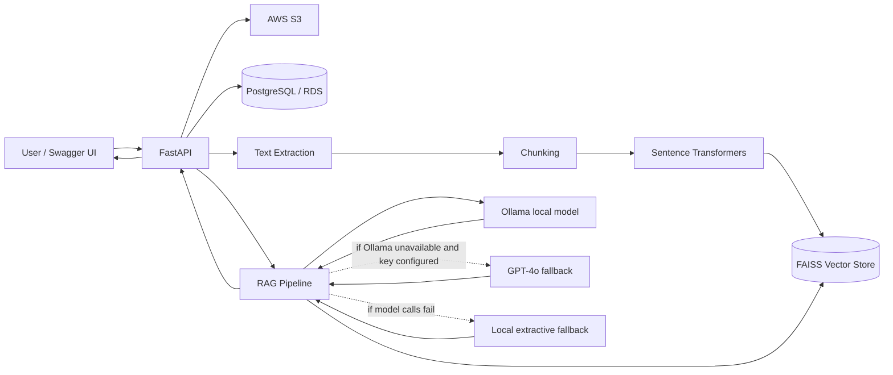

# Architecture

## Minimal production mapping

- FastAPI runs in Docker on AWS EC2.
- Docker image is stored in AWS ECR.
- Uploaded files are stored in AWS S3.
- Metadata is stored in AWS RDS PostgreSQL.
- Logs go to CloudWatch through the EC2/Docker logging setup.
- GitHub Actions runs tests and can build/push the image.
